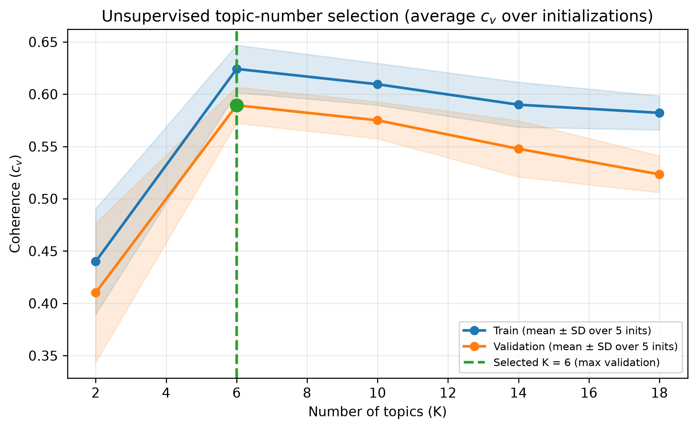
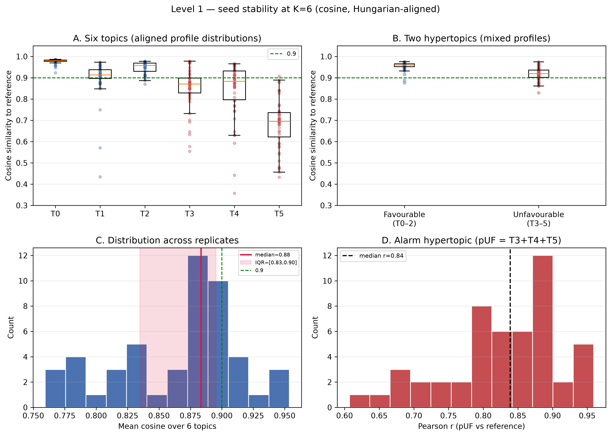
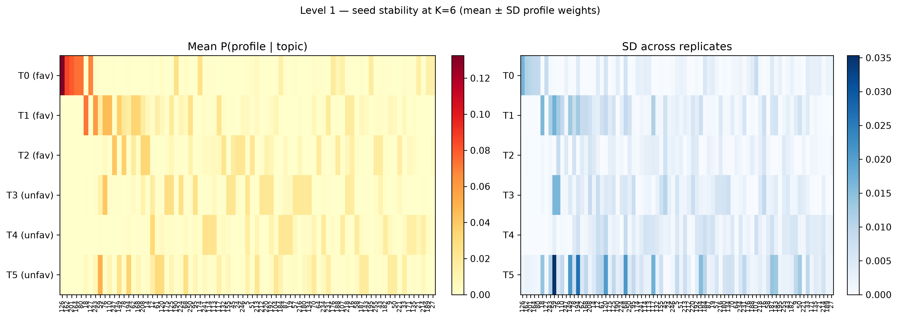
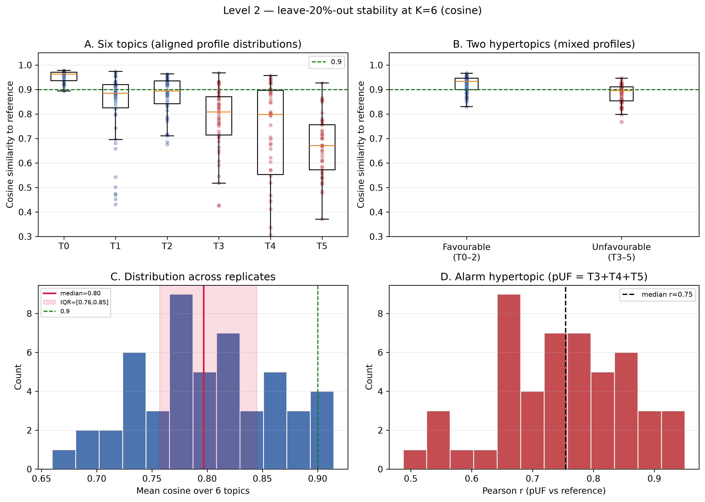
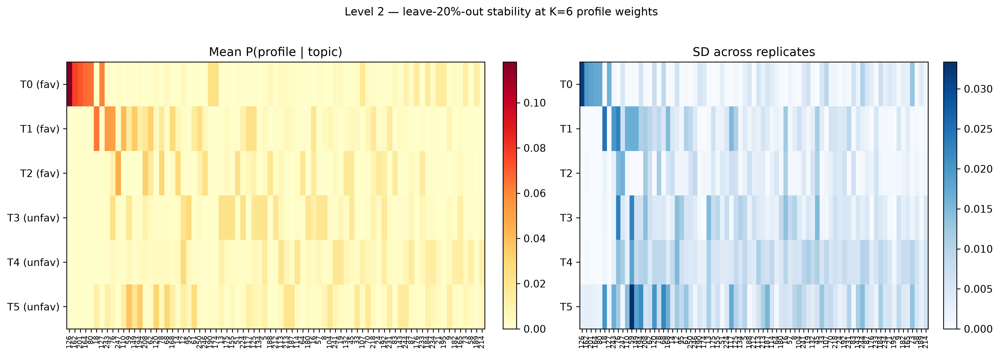

# LDA topic-number selection and stability report

Similarity metric throughout: **cosine** between aligned `P(day-type | topic)` distributions (Hungarian matching to the published reference).

---

## 1. Unsupervised selection of K

We compared several candidate values of **K** using mean topic coherence (**c_v**) over 5 initializations (train/validation 70/30).  
**Rule:** maximise mean validation coherence → **K = 6**.



Published LDA: K = 6 re-trained with many passes (~100 000), `models/lda/LDA_model_vdec25.gensim`.

---

## 2. Level 1 — Stability to random seed

Re-fit LDA **50 times** at K = 6 (all patients; different seeds). Align topics to the reference; report **cosine** similarity of topic–profile distributions and patient **pUF** concordance.

### Headline (cosine)

| Summary | Value |
|---------|------:|
| Median cosine (all topic–replicate pairs) | **0.912** |
| IQR | **[0.836, 0.964]** |
| Median of per-replicate mean cosine (6 topics) | **0.883** |
| IQR of per-replicate mean cosine | **[0.835, 0.895]** |
| Favourable hypertopic cosine (median) | **0.960** |
| Unfavourable hypertopic cosine (median) | **0.919** |
| Patient pUF Pearson r (median [IQR]) | **0.839 [0.798, 0.887]** |

| Topic | Hypertopic | Cosine median [IQR] |
|------:|------------|--------------------:|
| T0 | favourable | 0.981 [0.977, 0.983] |
| T1 | favourable | 0.914 [0.897, 0.938] |
| T2 | favourable | 0.958 [0.930, 0.969] |
| T3 | unfavourable | 0.871 [0.829, 0.898] |
| T4 | unfavourable | 0.883 [0.796, 0.932] |
| T5 | unfavourable | 0.695 [0.622, 0.736] |





---

## 3. Level 2 — Stability to data (leave-20%-out)

Same K = 6 and cosine alignment, but each replicate **drops 20% of patients at random** (n = 50 replicates) and re-fits LDA on the remainder.

### Headline (cosine)

| Summary | Value |
|---------|------:|
| Median cosine (all topic–replicate pairs) | **0.867** |
| IQR | **[0.706, 0.927]** |
| Median of per-replicate mean cosine | **0.797** |
| Favourable / unfavourable hypertopic cosine (median) | **0.933** / **0.896** |
| Patient pUF Pearson r (median [IQR]) | **0.754 [0.660, 0.830]** |

| Topic | Hypertopic | Cosine median [IQR] |
|------:|------------|--------------------:|
| T0 | favourable | 0.963 [0.936, 0.970] |
| T1 | favourable | 0.885 [0.825, 0.920] |
| T2 | favourable | 0.894 [0.842, 0.936] |
| T3 | unfavourable | 0.808 [0.714, 0.870] |
| T4 | unfavourable | 0.798 [0.553, 0.896] |
| T5 | unfavourable | 0.671 [0.572, 0.757] |





---

## 4. Interpretation

- **K = 6** maximises mean validation coherence among the candidates evaluated.
- **Level 1 (seed):** topic–profile cosine has **median > 0.9**; hypertopics and **pUF** remain highly concordant → the alarm input is stable to re-initialisation.
- **Level 2 (leave-20%-out):** cosine remains high for most topics/hypertopics under patient subsampling; use the heatmaps (mean ± SD of day-type weights) to show which profiles stay dominant.
- Alarm analyses are **not** re-run unless pUF concordance were poor.

---

## 5. Files

| Path | Content |
|------|---------|
| `coherence_coarse_grid.csv` | K-selection |
| `level1_seed_*.csv` / `level1_seed_summary.json` | Seed stability (cosine) |
| `level2_resample_*.csv` / `level2_resample_summary.json` | Leave-20%-out (cosine) |
| `../figures/lda_coherence_k_selection.*` | K figure |
| `../figures/stability/lda_stability_level1_cosine.*` | Level 1 |
| `../figures/stability/lda_stability_level2_resample_cosine.*` | Level 2 |
| `../figures/stability/*_profile_heatmap.*` | Mean ± SD profile weights |

```bash
.venv/bin/python scripts/03_analysis/lda/run_lda_stability.py --mode both --n-reps 50 --passes 100 --leave-out 0.2
```
