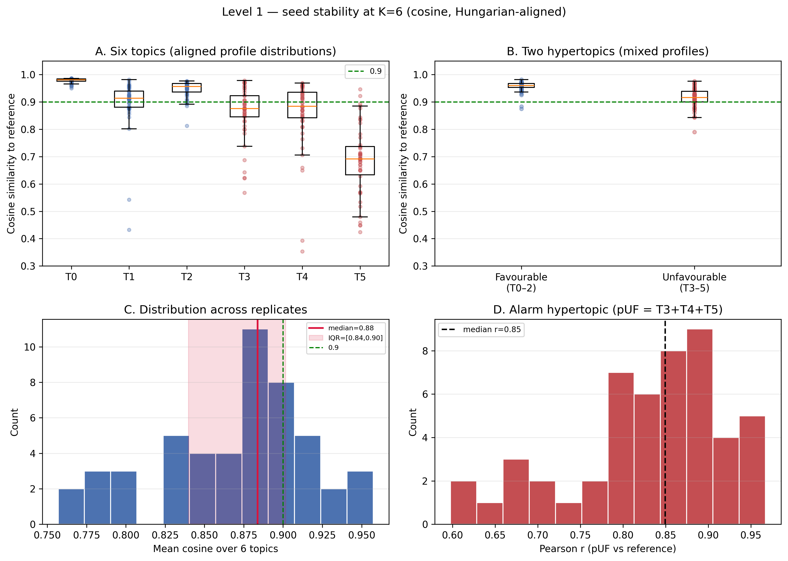
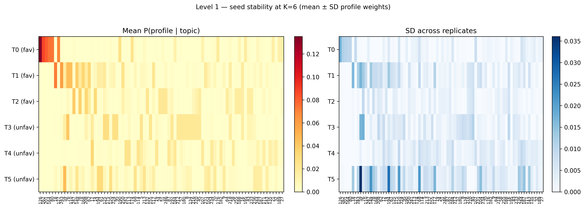
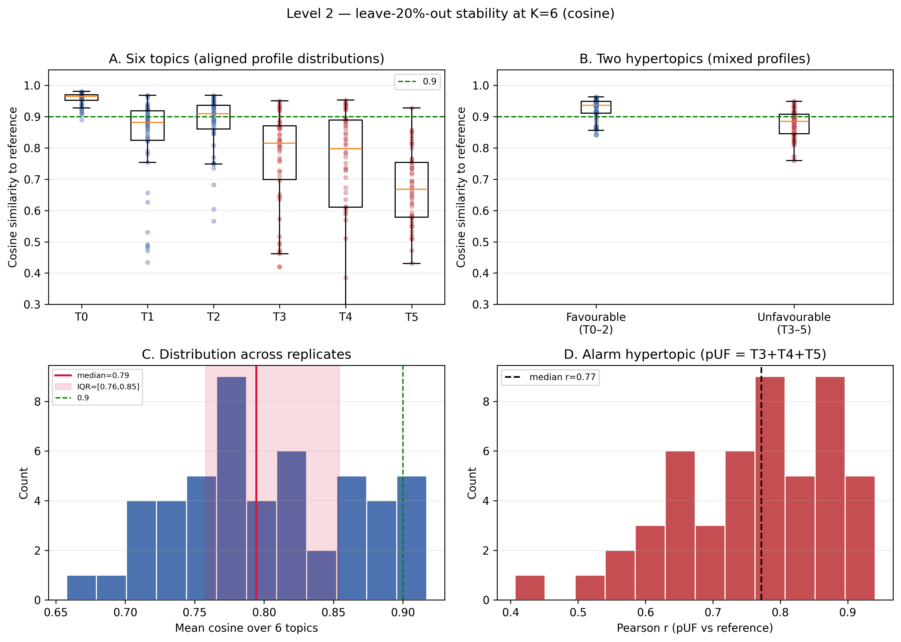
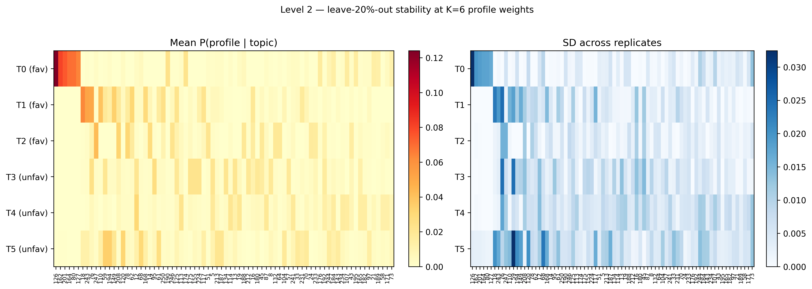

# LDA stability — revision (new CNIO dates)

Protocol identical to the lock-date analysis in `results/lda/stability/`, but day-type sequences from:

- **Profiles:** `data/revision/user_embeddings_revision_a0.csv`
- **Reference LDA:** `models/lda/LDA_model_vdec25.gensim` (unchanged)
- **Settings:** K=6, 50 reps, 100 passes, leave-out 20% (level 2)
- **Outputs:** this folder + `figures/` (original baseline left untouched)

Of 175 patients, **95** have different day-type sequences vs the prior embeddings; mean sequence length +2.5 tokens.

---

## Headline comparison (revision vs prior lock-date)

| Metric | Prior | Revision | Δ |
|--------|------:|---------:|--:|
| L1 median cosine (all topic–rep) | 0.912 | 0.915 | +0.003 |
| L1 median of mean cosine / rep | 0.883 | 0.884 | +0.000 |
| L1 favourable hypertopic cosine | 0.960 | 0.960 | +0.000 |
| L1 unfavourable hypertopic cosine | 0.919 | 0.916 | -0.003 |
| L1 pUF Pearson r | 0.839 | 0.849 | +0.010 |
| L2 median cosine (all topic–rep) | 0.867 | 0.867 | -0.000 |
| L2 median of mean cosine / rep | 0.797 | 0.794 | -0.002 |
| L2 favourable hypertopic cosine | 0.933 | 0.937 | +0.003 |
| L2 unfavourable hypertopic cosine | 0.896 | 0.885 | -0.011 |
| L2 pUF Pearson r | 0.754 | 0.772 | +0.018 |

### Level 1 — per-topic cosine median

| Topic | Prior | Revision | Δ |
|------:|------:|---------:|--:|
| T0 | 0.981 | 0.981 | +0.000 |
| T1 | 0.914 | 0.914 | +0.000 |
| T2 | 0.958 | 0.957 | -0.001 |
| T3 | 0.871 | 0.875 | +0.005 |
| T4 | 0.883 | 0.884 | +0.002 |
| T5 | 0.695 | 0.691 | -0.003 |

### Level 2 — per-topic cosine median

| Topic | Prior | Revision | Δ |
|------:|------:|---------:|--:|
| T0 | 0.963 | 0.965 | +0.002 |
| T1 | 0.885 | 0.882 | -0.003 |
| T2 | 0.894 | 0.909 | +0.015 |
| T3 | 0.808 | 0.815 | +0.007 |
| T4 | 0.798 | 0.797 | -0.001 |
| T5 | 0.671 | 0.668 | -0.004 |

---

## Figures









---

## Regenerate

```bash
./env/bin/python scripts/03_analysis/lda/run_lda_stability.py \
  --mode both --n-reps 50 --passes 100 --leave-out 0.2 \
  --profiles-csv data/revision/user_embeddings_revision_a0.csv \
  --out-dir results/lda/stability/revision \
  --fig-dir results/lda/stability/revision/figures
```


PDF: [`lda_stability_report_revision.pdf`](lda_stability_report_revision.pdf)
